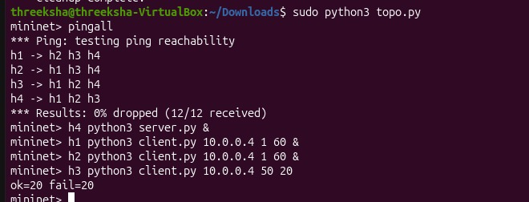
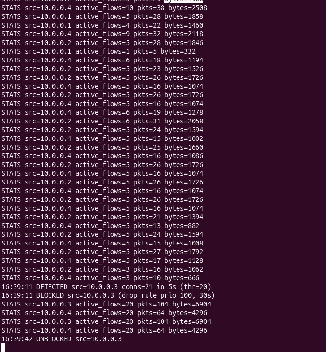

# Dynamic Host Blocking System (SDN + TCP Sockets)

**Course project:** SDN – Socket Programming (Jackfruit Mini Project), Problem 12
**Team:**   Sudha Nigam, PES2UG25CS50
            Threeksha, PES2UG25CS587
            Tanvi Thakare

A TCP client/server application running on a Mininet network, controlled by a Ryu SDN controller. The controller watches connection rates per host, detects abnormal behaviour, and **dynamically blocks the suspicious host by installing an OpenFlow drop rule**. The block is lifted automatically after a timeout.

---

## 1. Problem Statement

Develop a system that identifies abnormal TCP traffic patterns and dynamically blocks suspicious hosts using SDN flow rules.

## 2. Architecture

```
        h1 (client)  ─┐
        h2 (client)  ─┤
                      ├── s1 (Open vSwitch) ──── h4 (TCP server)
        h3 (attacker)─┘          │
                                 │ OpenFlow 1.3
                           Ryu controller
                       (monitor → detect → block)
```

| Component | File | Role |
|---|---|---|
| Topology | `topo.py` | Mininet: 1 switch, 4 hosts, remote controller |
| TCP server | `server.py` | Runs on h4, accepts client connections |
| TCP client | `client.py` | Normal clients (h1, h2) and attacker (h3), only the connection rate differs |
| SDN controller | `controller.py` | Ryu app `HostBlocker`: counts connections, collects flow stats, blocks hosts |
| Log | `events.log` | DETECTED / BLOCKED / UNBLOCKED events |

### Communication flow
1. Clients open TCP connections to the server on h4.
2. Packets reach the switch; the controller sees new connections and counts them per source IP in a sliding window.
3. The controller also polls flow statistics periodically (`STATS` lines: active flows, packets, bytes per source).
4. If a source exceeds the threshold, it is marked suspicious and added to the blocklist.
5. The controller installs a high-priority **drop** flow rule for that source IP on the switch.
6. After the block timeout, the rule expires and the host is unblocked.

## 3. Features 

| Requirement | How it is done |
|---|---|
| Generate TCP traffic from multiple hosts | `client.py` on h1, h2, h3 → `server.py` on h4 |
| Monitor connection rates | Per-source connection count in a 5 s sliding window |
| Collect flow statistics | Periodic OpenFlow flow-stats requests, logged as `STATS` |
| Define abnormal traffic thresholds | `thr = 20` connections in 5 s |
| Detect suspicious hosts | Threshold check in the controller |
| Maintain a dynamic blocklist | Blocklist in the controller, entries added and removed at runtime |
| Install SDN drop rules | Flow-mod: match `ipv4_src`, no actions, priority 100, 30 s timeout |

## 4. Requirements

- Ubuntu (tested in a VirtualBox VM)
- Mininet and Open vSwitch
- Python 3.9 virtual environment with Ryu 
- Python 3 (for the socket programs)

### Setup
```bash
sudo apt update
sudo apt install -y mininet openvswitch-switch software-properties-common
sudo add-apt-repository ppa:deadsnakes/ppa
sudo apt update
sudo apt install -y python3.9 python3.9-venv python3.9-dev

python3.9 -m venv ~/ryu-env
source ~/ryu-env/bin/activate
pip install --upgrade pip wheel
pip install eventlet==0.30.2 ryu
```

## 5. How to Run

Use three terminals, all from the project folder.

**Terminal 1: controller**
```bash
source ~/ryu-env/bin/activate
ryu-manager controller.py
```

**Terminal 2: log viewer**
```bash
tail -F events.log
```

**Terminal 3: network**
```bash
sudo mn -c            # clean old state (optional)
sudo python3 topo.py
```

Then at the `mininet>` prompt:
```
mininet> pingall
mininet> h4 python3 server.py &
mininet> h1 python3 client.py 10.0.0.4 1 60 &
mininet> h2 python3 client.py 10.0.0.4 1 60 &
mininet> h3 python3 client.py 10.0.0.4 50 20
```
<!-- TODO: confirm what the client.py arguments mean, e.g. `<server_ip> <connections_per_sec> <duration_s>` -->

h1 and h2 behave normally. h3 floods connections and gets blocked.

## 6. Test Cases and Results

### Test 1: Connectivity
`pingall` → **0% dropped (12/12 received)**, so the topology and controller work.

### Test 2: Normal traffic
h1 and h2 send connections at a low rate. They are never flagged and keep communicating with h4 (see `STATS` lines for 10.0.0.1 and 10.0.0.2).

### Test 3: Attack detection and blocking
h3 sends connections at a high rate.

```
16:39:11 DETECTED src=10.0.0.3 conns=21 in 5s (thr=20)
16:39:11 BLOCKED  src=10.0.0.3 (drop rule prio 100, 30s)
16:39:42 UNBLOCKED src=10.0.0.3
```

- h3 was detected within the first window when it crossed 20 connections in 5 s.
- A drop rule was installed immediately, and the client reported `ok=20 fail=20`, i.e. half of its attempts failed once the block was active.
- The rule expired after 30 s and the host was unblocked automatically.
- h1, h2 were unaffected throughout.

### Screenshots
| | |
|---|---|
| Event log |  |
| Mininet run (pingall, server, clients) |  |
| Controller STATS + DETECT/BLOCK |  |

## 7. Challenging Scenario

Unauthorized / abusive host (connection flood) from h3 while legitimate clients h1 and h2 are active. The controller isolates only the offending host and legitimate traffic continues.

## 8. Repository Structure

```
.
├── controller.py     # Ryu SDN controller
├── topo.py           # Mininet topology
├── server.py         # TCP server (h4)
├── client.py         # TCP client / attacker
├── events.log        # sample log from a run
├── images/           # screenshots
└── README.md
```

## 9. Troubleshooting

- `No module named 'blocker'`: run `ryu-manager` from the folder containing the file, with the correct file name.
- `ryu-manager: command not found`: activate the venv with `source ~/ryu-env/bin/activate`.
- Mininet can't reach the controller: start `ryu-manager` first.
- Stale state after a crash: `sudo mn -c`.
